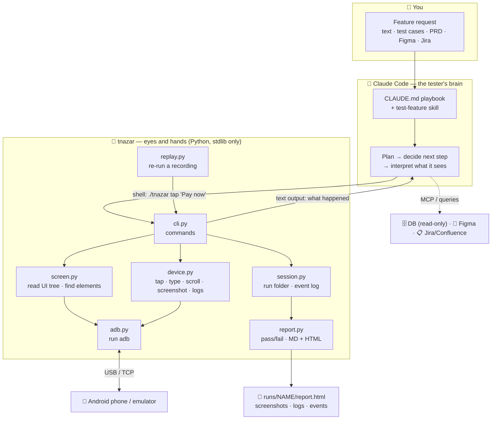
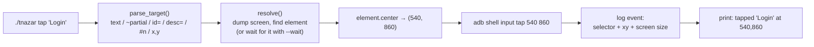
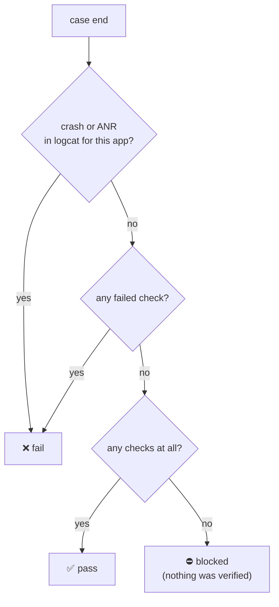
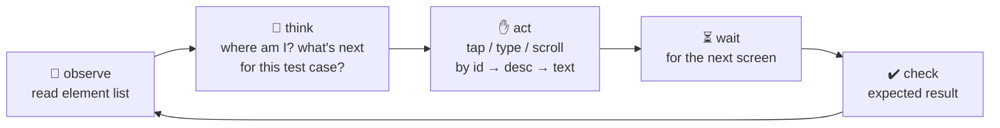
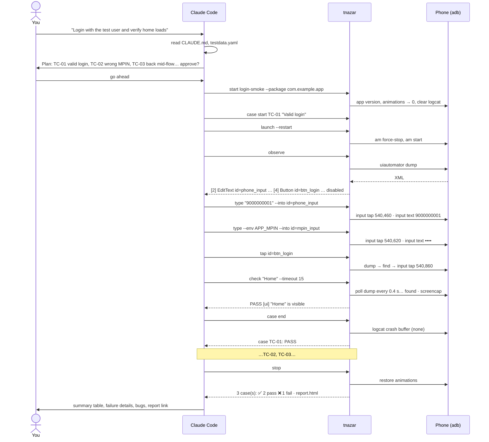
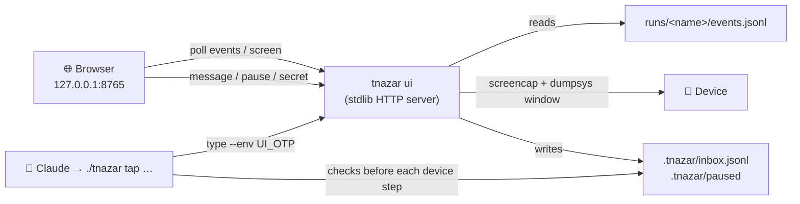

# Teesri Nazar — Architecture (HLD)

This document explains **what Teesri Nazar is, why it exists, and how every part of it
works**, from "you type a request" down to "a finger tap lands on the phone". It is
written so that a student who has never touched Android automation can follow it, and
an engineer can use it as the design reference.

> **Teesri Nazar** (तीसरी नज़र) means *"the third eye"*. Dev builds it, PM designs it,
> Teesri Nazar checks it.

---

## Contents

1. [The problem](#1-the-problem)
2. [The idea in one sentence](#2-the-idea-in-one-sentence)
3. [Words you need first](#3-words-you-need-first)
4. [The big picture](#4-the-big-picture)
5. [Layer 1 — Talking to the phone (ADB)](#5-layer-1--talking-to-the-phone-adb)
6. [Layer 2 — Reading the screen (the UI dump)](#6-layer-2--reading-the-screen-the-ui-dump)
7. [Layer 3 — Finding an element (selectors, not XPath)](#7-layer-3--finding-an-element-selectors-not-xpath)
8. [Layer 4 — Acting on the phone](#8-layer-4--acting-on-the-phone)
9. [Layer 5 — Verifying (checks)](#9-layer-5--verifying-checks)
10. [Layer 6 — Recording a run](#10-layer-6--recording-a-run)
11. [Layer 7 — Pass / fail and the report](#11-layer-7--pass--fail-and-the-report)
12. [The brain — how Claude decides](#12-the-brain--how-claude-decides)
13. [One request, end to end](#13-one-request-end-to-end)
14. [Replay — running a recording again](#14-replay--running-a-recording-again)
15. [The live dashboard](#15-the-live-dashboard)
16. [Design decisions and trade-offs](#16-design-decisions-and-trade-offs)
17. [How the tool itself is tested](#17-how-the-tool-itself-is-tested)
18. [Limits](#18-limits)
19. [Code map](#19-code-map)

---

## 1. The problem

Every new feature in a mobile app needs someone to **open the app on a phone and check
that it works**: tap through the flow, type the inputs, look at the result, try the edge
cases, take screenshots, and write up what passed and what failed.

Today that is done in one of two ways, and both hurt:

| Approach | What goes wrong |
|---|---|
| **Manual testing** | Slow, repetitive, easy to skip edge cases, evidence (screenshots, logs) is collected by hand or not at all, and nothing is left behind to re-run next release. |
| **Classic automation** (Appium, Espresso, scripts) | Someone has to *write and maintain code* for every screen. Selectors break when the UI changes. A new feature can't be tested until the automation is written — which is usually after the feature ships. |

What we actually want is a **tester**, not a script: something you can hand a feature
description and say *"test this"*, which decides what to check, does it on a real device,
and gives you a report with proof.

## 2. The idea in one sentence

> An AI agent (**Claude Code**) plays the role of a senior manual tester, and a small
> Python command-line tool (**`tnazar`**) gives it eyes and hands on an Android phone —
> while recording every step so the session becomes a report *and* a replayable test.

The split is deliberate:

- **Claude** does what humans are good at: reading a PRD, deciding what to test, noticing
  something looks wrong, choosing the next step.
- **`tnazar`** does what machines are good at: talking to the device precisely, finding
  elements reliably, waiting correctly, recording everything, and computing pass/fail
  from the evidence — the same way every time.

---

## 3. Words you need first

| Term | Plain meaning |
|---|---|
| **ADB** (Android Debug Bridge) | A command-line program from Google that lets a computer control an Android phone over USB or Wi-Fi: run shell commands on it, simulate taps, take screenshots, read logs. |
| **Emulator** | A virtual Android phone running on your computer. ADB treats it like a real one. |
| **UIAutomator** | A tool built into Android. Its `uiautomator dump` command writes the *current screen* as an XML file. |
| **UI tree / accessibility tree** | The structure Android keeps of what is on screen: every button, text, input box, nested inside layouts. Screen readers for blind users use the same tree. |
| **Node / element** | One item in that tree, e.g. a button. |
| **`resource-id`** | A developer-given name for an element, like `com.app:id/btn_login`. Stable across releases — the best way to find something. |
| **`content-desc`** | The accessibility label (what a screen reader would say), e.g. `"Navigate up"`. |
| **`text`** | The visible text, e.g. `"Pay now"`. |
| **`bounds`** | The element's rectangle on screen in pixels: `[left,top][right,bottom]`. |
| **Selector** | A rule for finding an element: "the one whose id is `btn_login`", or "the one whose text is `Pay now`". |
| **XPath** | A query language for XML used by tools like Appium (`//android.widget.Button[@text='Login']`). **Teesri Nazar does not use XPath** — see [§7](#7-layer-3--finding-an-element-selectors-not-xpath). |
| **Run** | One testing session, saved to `runs/<name>/`. |
| **Case** | One test case inside a run, e.g. `TC-01 Login with valid MPIN`. |
| **Check** | One verified expectation inside a case. Pass or fail. |
| **MCP** | Model Context Protocol — how Claude connects to other tools (Figma, Jira/Confluence). |

---

## 4. The big picture



Read it top to bottom:

1. **You** describe the feature.
2. **Claude** follows the playbook in `CLAUDE.md`, writes a test plan, and then drives the
   device one command at a time.
3. Each command is a normal shell call to **`./tnazar`**. It does one precise thing,
   prints the result as text, and appends an event to the run's log.
4. `tnazar` talks to the **phone** only through **ADB**.
5. At the end, the event log becomes a **report**.

Claude never touches the phone directly, and `tnazar` never decides what to test. That
boundary is the most important design choice in the project.

---

## 5. Layer 1 — Talking to the phone (ADB)

*File: `teesri_nazar/adb.py`*

Everything that reaches the device goes through one small class, `Adb`. It runs the
`adb` program as a subprocess:

```
adb -s <serial> shell input tap 540 860
└┬┘ └────┬────┘ └──────────┬──────────┘
 │       │                 └ the command to run on the phone
 │       └ which device (there may be several)
 └ the adb binary (found via $ANDROID_HOME/platform-tools, or $PATH)
```

**Which device?** `pick_serial()` decides, in order:

1. `--device <serial>` if you passed one,
2. the device of the active run,
3. `$ANDROID_SERIAL`,
4. the only connected device — or an error asking you to choose if there are several.

**Everything is synchronous with a timeout.** If adb hangs (it can), the call fails with
a clear `AdbError` instead of freezing the run.

The ADB commands `tnazar` relies on:

| Need | ADB command used |
|---|---|
| Read the screen | `uiautomator dump` (see §6) |
| Tap / long-press | `input tap x y` / `input swipe x y x y 800` |
| Type | `input text "..."` |
| Press a key | `input keyevent 4` (back), `66` (enter), … |
| Swipe / scroll | `input swipe x1 y1 x2 y2 ms` |
| Screenshot | `exec-out screencap -p` (PNG bytes straight back) |
| Launch app | `cmd package resolve-activity` → `am start -W -n <activity>` (fallback: `monkey`) |
| Clear app data | `am force-stop` + `pm clear` |
| Deep link | `am start -a android.intent.action.VIEW -d <url>` |
| App version | `dumpsys package <pkg>` → `versionName`, `versionCode` |
| Crash / ANR | `logcat -b crash` and `logcat -b system -e "ANR in"` |
| Speed up UI | `settings put global *_animation_scale 0` |

---

## 6. Layer 2 — Reading the screen (the UI dump)

*File: `teesri_nazar/screen.py` → `capture()`, `parse()`*

A human tester *looks* at the screen. `tnazar` *reads* it. Android can describe its
current screen as XML, and that XML is the single source of truth for "what is on screen".

### 6.1 Getting the dump — in one round trip

```bash
adb exec-out "rm -f /sdcard/tnazar-ui.xml; \
              uiautomator dump /sdcard/tnazar-ui.xml >/dev/null 2>&1; \
              cat /sdcard/tnazar-ui.xml"
```

Dump to a file on the phone and print it back, all in **one** adb call (~2–3 s). If the
screen is mid-animation, `uiautomator` sometimes returns nothing; `capture()` retries up
to 3 times with a growing pause.

### 6.2 What the dump looks like

A login screen (this is the real test fixture `tests/fixtures/login.xml`, trimmed):

```xml
<hierarchy rotation="0">
  <node class="android.widget.FrameLayout" bounds="[0,0][1080,2400]" ...>
    <node class="android.widget.TextView" text="Welcome back"
          resource-id="com.example.app:id/title"       bounds="[60,200][1020,300]" />
    <node class="android.widget.EditText" content-desc="Phone number"
          resource-id="com.example.app:id/phone_input" bounds="[60,400][1020,520]"
          clickable="true" focused="true" />
    <node class="android.widget.EditText" password="true"
          resource-id="com.example.app:id/mpin_input"  bounds="[60,560][1020,680]" clickable="true" />
    <node class="android.widget.Button" text="Login" enabled="false"
          resource-id="com.example.app:id/btn_login"   bounds="[60,800][1020,920]" clickable="true" />
    <node class="android.widget.TextView" text="Help"
          resource-id="com.example.app:id/link"        bounds="[60,1000][500,1060]" clickable="true" />
    <node class="android.widget.TextView" text="Terms of service"
          resource-id="com.example.app:id/link"        bounds="[580,1000][1020,1060]" clickable="true" />
  </node>
</hierarchy>
```

### 6.3 Turning XML into elements

`parse()` walks every `<node>` and builds an `Element`:

```
Element(index, cls, text, rid, desc, bounds,
        clickable, enabled, checked, focused, scrollable, password, package)
```

- **bounds → center.** `[60,800][1020,920]` → center `(540, 860)`. The center is where a
  tap will land.
- **Zero-size nodes are dropped** (invisible layout leftovers).
- **`index`** is just the element's position in this list, so `observe` can label it
  `[4]` and you can say `tap '#4'`.

### 6.4 What Claude actually sees — `observe`

Most nodes are empty layout boxes. `observe` shows only the *interesting* ones —
anything with text, a label, or that can be tapped, scrolled, typed into or checked
(switches and checkboxes show `checked` / `unchecked`):

```
$ ./tnazar observe
screen: com.example.app  8 elements (7 shown)
[1] TextView id=title text="Welcome back" @540,250
[2] EditText id=phone_input desc="Phone number" @540,460 tap focused
[3] EditText id=mpin_input @540,620 tap password
[4] Button id=btn_login text="Login" @540,860 tap disabled
[5] TextView id=link text="Help" @280,1030 tap
[6] TextView id=link text="Terms of service" @800,1030 tap
[7] Switch id=remember_me @960,1180 tap unchecked
```

This compact text is the agent's "eyesight". It is cheap (a few hundred tokens), exact
(no guessing pixels from an image), and carries state a screenshot can't show clearly
(`disabled`, `password`, `focused`, `unchecked`). The full XML is also saved to `runs/<name>/dumps/`
and to `.tnazar/last-screen.xml`, so `#index` taps can reuse it without a new dump.

Screenshots are still taken — as **evidence for humans**, not as the agent's input.

---

## 7. Layer 3 — Finding an element (selectors, not XPath)

*File: `teesri_nazar/screen.py` → `Selector`, `find()`, `stable_selector()`*

### 7.1 Why not XPath?

Tools like Appium usually locate elements with XPath over this same XML, e.g.
`//android.widget.FrameLayout/android.widget.Button[2]`. That is powerful, but it is
**brittle**: it encodes the *layout structure*, so wrapping a button in one extra layout
breaks the test even though nothing a user sees has changed.

Teesri Nazar instead matches on **what the element is**, not **where it sits in the
tree**. A selector is just up to three attributes:

```python
Selector(id="btn_login")          # resource-id
Selector(desc="Navigate up")      # accessibility label
Selector(text="Pay now")          # visible text
Selector(text="Pay", contains=True)   # partial text
Selector(id="link", text="Help")  # combine to disambiguate
Selector(text="Delete", nth=1)    # the 2nd match
```

The location is never queried — it is **computed**: find the element in the flat list,
take its `bounds`, compute the center, tap there.

### 7.2 How matching works

`find_all()` scans the element list and keeps every element that satisfies **all** the
attributes given:

- **id:** `btn_login` matches `com.example.app:id/btn_login` (short form is fine).
- **text / desc:** whitespace-collapsed and case-insensitive. Exact by default;
  substring with `~` / `--contains`.
- **Forgiving fallback:** if an exact text match fails, `find()` retries as a partial
  match — a label typed loosely (`"Pay now"`) often lives inside a longer string
  (`"Pay now ₹500"`).

### 7.3 The priority rule: id → desc → text → coordinates

When the agent writes a target, it is told (by `CLAUDE.md`) to prefer, in order:

| Rank | Target | Why |
|---|---|---|
| 1 | `id=btn_pay` | Set by developers, doesn't change with copy or language. |
| 2 | `desc="Navigate up"` | Accessibility labels are fairly stable, and icons often have no text. |
| 3 | `"Pay now"` | Visible text — readable, but changes with copywriting / localisation. |
| 4 | `540,1860` | Raw pixels — last resort. Breaks on a different screen size or layout. |

### 7.4 Turning `#index` into a durable selector

When the agent taps `'#4'` from the last `observe`, `tnazar` does **not** record "index 4"
or "540,860" — those would mean nothing on a replay. `stable_selector()` picks the most
durable selector that **uniquely** identifies that element on that screen:

```
candidates for an element:  id  →  desc  →  text  →  id+text
pick the first one that matches exactly one element on screen;
otherwise the first one that matches it, plus nth = its position among matches.
```

From the login screen above:

| Tapped | Recorded selector | Why |
|---|---|---|
| `#4` (Login) | `id=btn_login` | id is unique → best choice. |
| `#3` (MPIN box) | `id=mpin_input` | unique id; its text is never used because it's a password field. |
| `#5` (Help) | `"Help"` | `id=link` is shared by Help *and* Terms, so id alone is ambiguous → falls through to text. |

That one function is why a session done "by hand" by the agent is replayable later.

---

## 8. Layer 4 — Acting on the phone

*Files: `teesri_nazar/cli.py` (commands), `teesri_nazar/device.py` (device actions)*

Every action follows the same path:



| Command | What it does under the hood |
|---|---|
| `tap` | Find → center → `input tap`. `--long` = a swipe that doesn't move for 800 ms. |
| `type` | Optionally tap the field (`--into`), clear it (`--clear`: move cursor to end, then backspace N times), then `input text`. Spaces and shell-special characters are escaped. ASCII only. |
| `key` | Named key → Android keycode (`back`=4, `enter`=66, …) → `input keyevent`. |
| `scroll` | Swipe 30% of the area from the middle. `down` *reveals what's below* (finger moves up). `--to X` repeats until X is visible, and stops early if the screen stops changing (end of list). |
| `swipe` | Raw coordinates. Screen size is recorded so replay can scale it. |
| `launch` | Resolve the app's launcher activity and start it. Plain `launch` resumes the app where it was; `--restart` force-stops first, `--fresh` also clears data, and both start with `NEW_TASK\|CLEAR_TASK` so activities left in the task (including other packages' ones) are dropped. |
| `open-url` | Fire a VIEW intent — for deep links. |
| `wait` | Poll the screen every 0.4 s until the element appears (or with `--gone`, disappears). |

**Waiting instead of sleeping.** Apps load at different speeds. Fixed `sleep 3` is either
too slow or too short. `wait` / `tap --wait 10` / `check --timeout` all poll the UI tree
until the condition is true or the timeout expires.

**Animations off.** `start` sets the phone's three animation scales to 0 so screens settle
immediately and dumps don't catch half-drawn screens. The old values are saved in
`run.json` and restored by `stop` (and by a Claude Code `SessionEnd` hook if a session
ends with a run still open). They are also saved on the device itself, in
`/data/local/tmp/tnazar-animations`: if a run never restored them (device unplugged,
host killed, a different `TNAZAR_HOME`), the next `start` reads that file instead of
taking 0 as the baseline. Restoring deletes the file.

**Secrets never touch the log.** `type --env APP_MPIN` reads the value from `.env`; the
event records `"text": null, "secret": true, "env": "APP_MPIN"` — the name, never the value.
Typing into a `password="true"` field is treated as secret automatically.

---

## 9. Layer 5 — Verifying (checks)

*File: `teesri_nazar/cli.py` → `cmd_check`*

A test without assertions is just a demo. Every expected result becomes a **check**.

### UI checks (automatic)

```bash
./tnazar check "Payment successful"                 # visible within 5 s
./tnazar check id=loader --gone --timeout 15        # disappears
./tnazar check id=btn_login --enabled false         # state
./tnazar check id=tnc_checkbox --checked true
```

`tnazar` polls the UI tree until the element is found (or gone), then compares the
`enabled` / `checked` flags. A dump that fails mid-animation is retried until the timeout;
only a screen that never dumps is an error. Every check — pass or fail — **saves a
screenshot** when it can: on screens that block capture (`FLAG_SECURE`) the check and case
result are still recorded, with a warning instead of the shot. A failing check also saves
the full XML dump, so you can see exactly what *was* on screen.

### DB / Figma / API checks (agent-verified, tnazar-recorded)

`tnazar` doesn't connect to databases or Figma itself. Claude does the verification with
its own tools and records the outcome:

```bash
./tnazar check --result pass --kind db --what "txn row status = SUCCESS" \
    --detail "select status from txn where id='T123' -> SUCCESS"
./tnazar check --result fail --kind figma --what "CTA copy matches design" \
    --detail "Figma: 'Pay now', app: 'Pay Now'" --shot
```

Rules from the playbook: DB access is **read-only** and **test environment only**; the
query and its result go in `--detail` so a reviewer can reproduce it.

### Notes

`./tnazar note "Amount field accepts 0" --kind bug` records an observation, bug,
question or risk. Bugs are collected into their own section of the report.

---

## 10. Layer 6 — Recording a run

*File: `teesri_nazar/session.py`*

Everything that happens is appended to an **event log**. Nothing is ever edited in place.

```
runs/login-smoke/
├── run.json        ← metadata: device, model, Android version, app + version,
│                     the original request, start/finish time, saved animation values
├── events.jsonl    ← one JSON line per thing that happened (the source of truth)
├── shots/          ← screenshots (every check, every failure, explicit `shot`)
├── dumps/          ← UI tree XML (every observe, every failed check)
├── logs/           ← logcat and crash text for failed / crashed cases
├── report.md       ← generated at stop
└── report.html     ← generated at stop — the one to share
```

A few lines of `events.jsonl`:

```json
{"t":"…Z","type":"case_start","case":"TC-01","title":"Login with valid MPIN"}
{"t":"…Z","type":"type","text":null,"secret":true,"env":"APP_MPIN","selector":{"id":"mpin_input"},"xy":[540,620],"screen":[1080,2400],"clear":false,"enter":false}
{"t":"…Z","type":"tap","selector":{"id":"btn_login"},"xy":[540,860],"label":"Login","long":false,"screen":[1080,2400]}
{"t":"…Z","type":"check","kind":"ui","ok":true,"what":"\"Home\" is visible","selector":{"text":"Home"},"shot":"shots/101502-check-pass.png","case":"TC-01"}
{"t":"…Z","type":"case_end","case":"TC-01","status":"pass","reason":""}
```

Why an append-only log?

- **It is the recording.** Each action stores *both* the selector and the coordinates and
  screen size, which is everything replay needs.
- **It is crash-safe.** If the session dies, everything up to that moment is on disk.
- **Reports are derived, not written.** Re-running `./tnazar report <run>` rebuilds the
  report from the log at any time.

**One active run at a time.** `.tnazar/active.json` points to the current run and device,
so every command (`tap`, `check`, …) knows where to log without being told.

---

## 11. Layer 7 — Pass / fail and the report

*Files: `teesri_nazar/cli.py` → `_end_case`, `teesri_nazar/report.py`*

### How a case gets its result

The agent wraps steps in `case start TC-01 "title"` … `case end`. At `case end`,
`tnazar` — not the agent — decides the result from the evidence:



- logcat is cleared at `case start`, so a crash found at `case end` belongs to this case.
- The agent **can** pass `blocked --reason "backend down"` or `skipped` explicitly.
- The agent **cannot** mark a case `pass` if a check failed or the app crashed —
  `tnazar` overrides it to `fail` and notes that the tester tried to pass it.
- On fail / blocked / crash, an end-of-case screenshot and a logcat dump are attached
  automatically as evidence.

This is a key safety rail: **the AI decides what to check; the tool decides whether it passed.**

### The report

`./tnazar stop` builds `report.md` and a self-contained `report.html` from `events.jsonl`:

- header: app + version, device, Android version, duration, the original request;
- summary tiles: pass / fail / blocked / skipped, checks passed out of total;
- a case table with result and reason;
- per case: every check (✅/❌ with kind and detail), notes, crash logs, screenshots;
- a "Bugs found" section collected from `note --kind bug`.

Finally, Claude reports back in chat: summary line, case table, each failure as
*expected vs. actual*, bugs, what was not tested, and the path to `report.html`.

---

## 12. The brain — how Claude decides

*Files: `CLAUDE.md`, `.claude/skills/test-feature/SKILL.md`, `.claude/settings.json`*

There is **no AI code inside `tnazar`** (with one optional exception, visual replay in
§14). The intelligence comes from running **Claude Code** in this folder. Claude Code
automatically loads:

| File | Role |
|---|---|
| `CLAUDE.md` | The **playbook**: "you are a senior QA engineer"; the workflow (plan → start → cases → stop → report); how to drive the device; how to verify; the rules. |
| `.claude/skills/test-feature/SKILL.md` | A **skill** that triggers when you ask to test / QA / verify a feature, and points Claude through the same steps. |
| `.claude/settings.json` | **Permissions** (`./tnazar` and `adb devices` may run without prompting) and a **`SessionEnd` hook** that runs `./tnazar stop --if-active` so a run is never left open with animations off. |
| `testdata.yaml` (yours, gitignored) | Test accounts, environment, DB and Figma pointers. Read by Claude, not by `tnazar`. |
| `.env` (yours, gitignored) | Secrets (MPIN, OTP) — referenced only by name via `--env`. |

### What Claude decides vs. what tnazar decides

| Decision | Who |
|---|---|
| Which test cases to run, including missed edge cases (empty input, back mid-flow, retry, boundary amounts, kill & reopen) | 🤖 Claude |
| What to tap next, what to type, when a screen "looks wrong" | 🤖 Claude |
| What each expected result is, and recording it as a check | 🤖 Claude |
| Whether a DB row / Figma frame matches | 🤖 Claude (via its own tools) |
| Which element a selector matches, and where its center is | 🧰 tnazar |
| How long to wait, and whether the element appeared | 🧰 tnazar |
| Which selector to *record* so it can be replayed | 🧰 tnazar |
| Whether the case passed, failed or was blocked | 🧰 tnazar |
| Detecting crashes / ANRs | 🧰 tnazar |
| Keeping secrets out of logs | 🧰 tnazar |

### The agent's inner loop



Rules the playbook enforces on this loop:

- **Never guess a tap from a screenshot — `observe` first.**
- Observe once, then act (`tap '#12'` reuses the last dump; no extra 2–3 s).
- After anything that navigates, `wait` for the next screen instead of sleeping.
- If something outside the feature breaks (login, network, backend), mark the dependent
  cases **blocked** with the reason — don't report them as feature failures.
- Never print or note passwords, MPINs, OTPs or customer data.

### How Claude reads the outside world

- **PRD / Confluence / Jira / Zephyr** — via the Atlassian MCP.
- **Figma** — via the Figma MCP (`get_screenshot`, `get_design_context`), compared with a
  `./tnazar shot` of the app: copy, element presence, order, obvious colour/spacing issues.
- **DB** — read-only queries against the test environment in `testdata.yaml`; refuses
  anything that looks like production.

---

## 13. One request, end to end

*"Login with the test user and verify the home screen loads."*



---

## 14. Replay — running a recording again

*File: `teesri_nazar/replay.py`*

Because every step was recorded with a selector, a finished run is also a regression test:

```bash
./tnazar replay login-smoke             # same app state
./tnazar replay login-smoke --fresh     # clear app data first
./tnazar replay login-smoke --visual    # also compare screenshots with Claude
```

How it works:

1. Load `runs/login-smoke/events.jsonl`. Create a **new run** `login-smoke-replay-<time>` —
   so a replay gets its own full report.
2. Walk the events in order:
   - **actions** (`tap`, `type`, …) → re-find the element **by its recorded selector**
     (waiting up to `--step-timeout`, default 10 s), then act on its *new* center.
     No selector? Use the recorded coordinates, **scaled** to the new screen size
     (`x × new_width / old_width`).
   - **`key back`** → the recording notes whether the keyboard was open. Back over an open
     keyboard only closes it, so if the keyboard state differs on replay, the back is
     skipped (keyboard already hidden) or an extra back is pressed first (keyboard open
     now but not then).
   - **UI checks** → re-verified for real, with new screenshots.
   - **DB / Figma checks** → can't be re-verified automatically; logged as notes.
   - **secrets** → re-read from the same `$ENV` name on the replaying machine.
3. If a step fails, the rest of that case is skipped and the case is marked **blocked**;
   replay moves on to the next case.
4. Exit code `0` only if every case and check passed — usable in CI.

### Visual comparison (`--visual`)

Selectors prove the *same elements* exist; they don't prove the screen *looks* right.
With `--visual`, `visual.py` hands each (original, replay) screenshot pair to Claude in
headless mode:

```bash
claude -p "<compare these pairs…>" --allowedTools Read --output-format json
```

Claude is told to ignore the status bar, clocks, OTPs and other naturally changing
values, and to fail on a different screen, missing/extra elements, wrong text, error
dialogs or broken layout. Each verdict becomes a check with a one-sentence reason. This
uses tokens, so it is opt-in.

---

## 15. The live dashboard

*Files: `teesri_nazar/ui.py`, `teesri_nazar/ui.html`, `teesri_nazar/live.py`*

`./tnazar ui` opens a localhost page with three resizable panes: the **timeline** of the
run (Claude's narration with every step under it and how long it took), a **control** pane
to steer the agent, and the device **screen**, refreshed about every 1.5 s.



There is no channel into Claude itself: Claude runs one short `tnazar` command per step, so
**every device command is a checkpoint**.

- **Messages.** Before a device command (`tap`, `type`, `check`, `scroll`, …) runs, unread
  messages are printed as `>> USER (dashboard): …`, recorded as `user_msg` events, and the
  command is **not run** (exit 3), so Claude re-plans with the new instruction. Other commands
  (`say`, `note`, `case`) show pending messages without consuming them, so a chained
  `say … && tap …` still stops at the tap. Messages sent before `start` are dropped.
- **Pause.** While `.tnazar/paused` exists a device command waits up to 60 s (under the
  agent's 2-minute command timeout); if still paused it exits 3 and tells Claude to run
  `./tnazar wait-resume`. The wait is logged as a `hold` event.
- **Narration and timings.** `./tnazar say "…"` records a `say` event, the timeline heading
  for the steps after it. Every action event carries `dur_ms`; `wait` and `check` add
  `polls` (screen dumps it took). Steps over 5 s are highlighted.
- **Secrets.** A value typed in the dashboard stays in the server's memory. Claude is told
  the name (`UI_OTP`) and types it with `--env UI_OTP`; `type` fetches it from the server
  with a per-session token (in `.tnazar/ui.json`, mode 600). `tnazar adb` arguments that
  contain any `.env` value or dashboard secret are logged as `••••`.
- **Secure screens.** The server reads `dumpsys window` and, when an on-screen window has
  `FLAG_SECURE`, shows *"Screen hidden by the app"* instead of a black frame. This is a
  capture limit, not a test failure; the timeline keeps going.
- **Safety.** The server binds `127.0.0.1` only, rejects any `Host` header other than
  `127.0.0.1:<port>` / `localhost:<port>` (DNS rebinding), needs the session token for every
  change, and serves files only from inside `runs/`.

Limit: a message reaches Claude only while it is running commands. If its turn has ended,
the message waits (the dashboard shows *waiting for the agent's next step*).

---

## 16. Design decisions and trade-offs

| Decision | Why | Cost |
|---|---|---|
| **AI as the tester, tool as the hands** | Planning and judgement are where AI helps; precise, repeatable device I/O and pass/fail rules belong in deterministic code. | Two moving parts to understand. |
| **ADB + UIAutomator, no Appium** | Nothing to install on the phone, no server, no app changes, works with any installed app. | Limited to what the accessibility tree exposes (§18). |
| **Python standard library only** | `git clone` and run. No `pip install`, no version conflicts; works on Python 3.9+. | Some things are hand-rolled (dotenv loading, HTML report). |
| **Text element list, not screenshots, as the agent's eyes** | Exact ids, text and state; cheap in tokens; no pixel guessing. | Can't "see" purely visual problems — hence Figma checks and `--visual`. |
| **Attribute selectors, not XPath** | Survive layout refactors; readable (`id=btn_pay`). | Need ids/labels to exist; fall back to text otherwise. |
| **Record selector + coordinates + screen size** | Replay can re-find elements, and still has a scaled fallback. | Slightly larger logs. |
| **One dump per `observe`, reuse via `#index`** | A dump costs 2–3 s; the agent shouldn't pay it twice for one decision. | `#index` is only valid until the screen changes. |
| **Poll, don't sleep** | Robust to slow and fast devices alike. | Each poll is a dump; long timeouts mean many dumps. |
| **Animations off during a run** | Fewer half-rendered dumps, faster runs. | Changes a device setting — restored on stop and by the session-end hook. |
| **tnazar derives pass/fail** | The agent can't talk itself into a pass. | The agent must record a check for every expectation, or the case is *blocked*. |
| **Append-only JSONL** | Crash-safe; the log *is* the recording; reports regenerate any time. | No random edits; corrections are new events. |
| **Secrets by env-var name** | Values never appear in commands, logs, recordings or reports. | Replaying machine needs the same `.env`. |

---

## 17. How the tool itself is tested

*Files: `tests/`, `.github/workflows/tests.yml`*

A testing tool that needs a phone to be tested is hard to trust in CI. So:

- **`tests/fakedevice.py`** is a scripted fake phone. `FakeApp` describes screens as lists
  of nodes and what tapping a node or pressing a key does; `FakeAdb` answers the same adb
  calls `tnazar` makes — serving the current screen as a UIAutomator XML dump and
  recording every command — and the clock is patched so waits finish instantly.
- Unit tests cover the screen parser and selectors, device helpers, run storage, every
  CLI command end to end, the case-result rules, report generation, and replay
  (faithful replay, regression detection, secret handling).
- **GitHub Actions** runs the suite on Python 3.9 and 3.13 on every push and PR — no
  Android SDK needed.

```bash
python3 -m unittest discover -s tests
```

---

## 18. Limits

- **Jetpack Compose** screens show no `resource-id` unless the app enables
  `testTagsAsResourceId`; selectors fall back to labels and text.
- **Flutter, WebView and canvas/game** screens expose little or nothing in the
  accessibility tree, so there is little to find.
- **Secure screens** (`FLAG_SECURE`, e.g. MPIN, card details) come out black in
  screenshots. The element tree still works.
- **Typing is ASCII-only** (`adb input text`): no ₹, Hindi or emoji.
- **One device, one active run at a time.**
- **Dashboard messages wait while Claude is idle** — they are delivered at its next command.
- **DB / Figma checks are not re-verified on replay** — they appear as notes.

---

## 19. Code map

```
tnazar                      entry script: puts the repo on sys.path, calls cli.main()
teesri_nazar/
├── adb.py        Layer 1   find adb, pick the device, run commands with timeouts
├── screen.py     Layer 2–3 dump + parse the UI tree; Element, Screen, Selector;
│                           find / find_all / stable_selector
├── device.py     Layer 4   tap, type (escaping), keys, swipe/scroll vectors, screenshot,
│                           launch, clear data, deep links, animations, logcat, crashes,
│                           wait_for (polling)
├── cli.py        Layer 4–5 every `tnazar` command; target parsing and resolution;
│                           checks; case start/end and the pass/fail rules; .env loading
├── session.py    Layer 6   run folder, run.json, append-only events.jsonl, artifacts,
│                           the active-run pointer
├── report.py     Layer 7   events → cases → summary → report.md + report.html
├── replay.py               re-run a recording by selector, re-check UI checks
├── live.py                 CLI side of the dashboard: inbox, pause, runtime secrets
├── ui.py / ui.html         `tnazar ui`: localhost server + the three-pane page
└── visual.py               optional screenshot comparison via headless Claude
CLAUDE.md                   the tester playbook Claude follows
.claude/skills/test-feature the "test a feature" skill
.claude/settings.json       permissions + SessionEnd safety hook
tests/                      unit tests + fakedevice.py (a fake phone for CI)
```

**If you read only three files**, read `CLAUDE.md` (how the tester thinks),
`teesri_nazar/screen.py` (how it sees), and `_end_case` in `teesri_nazar/cli.py`
(how it judges).
