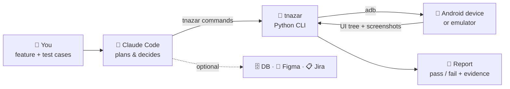

# 👁️ Teesri Nazar

**An AI tester for Android apps.**
Tell it what feature to test. It plans the test cases, runs them on a phone or emulator,
checks the results, and gives you a pass/fail report with screenshots.

> *Dev builds it, PM designs it, Teesri Nazar checks it.*

---

## What it does

| You give | It does | You get |
|---|---|---|
| A feature to test: plain text, test cases, PRD, Figma, Jira/Zephyr | Plans the cases, adds missed edge cases | A test plan to approve |
| Test accounts and environment | Runs every case on the device like a manual tester | Screenshots and logs as proof |
| DB / Figma details (optional) | Verifies the UI, the DB and the design | ✅ pass / ❌ fail / ⛔ blocked for each case |
| — | Records every step | A run you can replay later, on the same or another device |

---

## How it works (HLD)



**The loop for every step:**

1. **Look:** read the screen's element tree (text, ids, positions).
2. **Act:** tap, type or scroll on the right element, found by its **id**, then its **label**, then its **text**.
3. **Check:** is the expected thing on screen? (optionally also the DB and Figma)
4. **Record:** save the step, a screenshot and the result.

📐 **Full architecture, explained from scratch:** [ARCHITECTURE.md](ARCHITECTURE.md) — the
problem, ADB, the UI dump, how elements are found (and why not XPath), how Claude decides,
pass/fail rules, recording and replay.

---

## Tech stack

| Part | Technology |
|---|---|
| Brain | **Claude Code** (AI agent) |
| Toolkit | **Python 3.9+**, standard library only, no installs |
| Device control | **ADB** (Android Debug Bridge) |
| Reading the screen | **UIAutomator** dump (Android accessibility tree) |
| Design / tickets | **Figma MCP**, **Atlassian MCP** (optional) |
| Output | JSON event log, PNG screenshots, Markdown + HTML report |

No Appium, no Gradle, no app changes needed. It works with any installed app whose screens
show up in Android's accessibility tree (see [Limits](#limits)).

---

## Before you start

- **adb** (Android platform-tools) on your `PATH`, or `ANDROID_HOME` set
- A phone with USB debugging allowed, or a running emulator: `adb devices` should list it
- **Claude Code** installed (`claude` on your `PATH`)
- **Python 3.9+**

## Quick start

```bash
cd teesri-nazar
cp .env.example .env                  # test MPIN/OTP etc. (never logged)
cp testdata.example.yaml testdata.yaml   # accounts, env, DB, Figma links
claude
```

Then just ask:

```
Login with the test user and verify the home screen loads.
```

---

## Commands (if you want to drive it yourself)

| Command | What it does |
|---|---|
| `./tnazar start <name> --package <app>` | Start a test run |
| `./tnazar observe` | Show what's on screen |
| `./tnazar tap "Pay now"` | Tap by text (or `id=...`, `desc=...`, `#index`) |
| `./tnazar type --env APP_MPIN --into id=pin` | Type a secret from `.env` |
| `./tnazar check "Payment successful"` | Verify something is on screen |
| `./tnazar case start TC-01 "title"` / `case end` | Group steps into a test case |
| `./tnazar stop` | Finish and write the report |
| `./tnazar replay <name>` | Run a recorded test again |
| `./tnazar replay <name> --fresh` | Clear the app's data first, then replay |
| `./tnazar replay <name> --visual` | Also compare old and new screenshots with Claude (runs `claude -p`, uses tokens) |

Every run is saved in `runs/<name>/`, and `report.html` is the one to share.
Full command list: `./tnazar --help`, and `./tnazar <command> --help` for each one.

---

## Good to know

- **Run it from the repo root.** `tnazar` reads `.env` and writes `runs/` and `.tnazar/` in the
  folder you run it from (or in `$TNAZAR_HOME` if set).
- **It changes a device setting during a run.** `start` sets the device's three animation
  scales to 0 so screens settle faster. `stop` puts them back, and a Claude Code session-end
  hook stops any run left open. Use `start --keep-animations` to leave them alone.
- **Replay re-checks the UI only.** DB and Figma checks from the original run show up as
  notes, not re-verified results. Secrets typed with `--env` need the same `.env` on the
  machine that replays.

## Limits

- **Jetpack Compose** screens show no ids unless the app sets `testTagsAsResourceId`; taps
  fall back to labels and text.
- **Flutter, WebView and canvas** screens expose little or nothing in the accessibility tree.
- **Secure screens** (`FLAG_SECURE`, e.g. MPIN or card details) come out black in screenshots.
  The element tree still works.
- **Typing is ASCII-only** (adb `input text`): no ₹, Hindi or emoji.

---

## Project layout

```
tnazar                  ← the command
teesri_nazar/           ← Python code (adb, screen, session, report, replay)
ARCHITECTURE.md         ← HLD: how every layer works, with diagrams
CLAUDE.md               ← how the AI tester should work
.claude/skills/         ← "test-feature" skill
.env.example            ← secrets template: copy to .env (gitignored)
testdata.example.yaml   ← accounts, env, DB, Figma: copy to testdata.yaml (gitignored)
runs/                   ← one folder per run: events, screenshots, logs, report (gitignored)
tests/                  ← unit tests:  python3 -m unittest discover -s tests
                           (fakedevice.py stands in for adb, so tests and CI need no phone)
.github/workflows/      ← CI: runs the tests on Python 3.9 and 3.13 for every push
```

---

## Coming next

⚡ Faster screen reads · 📱 Parallel emulators · 🗄️ Built-in DB checks · 📋 Zephyr import
