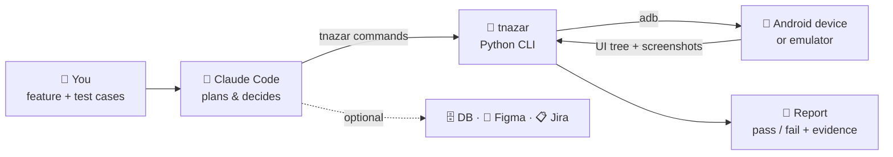

# 👁️ Teesri Nazar

**An AI tester for Android apps.**
Tell it what feature to test. It plans the test cases, runs them on a phone or emulator,
checks the results, and gives you a pass/fail report with screenshots.

> *Dev builds it, PM designs it, Teesri Nazar checks it.*

---

## 🎭 One agent, the whole team

- 🤖 **Claude**: the manager. Reads your request and decides what happens next.
- 🧪 **Senior QA**: plans the test cases and finds the edge cases.
- 🙋 **End user**: taps through the app on a real phone, like a customer.
- 👩‍💻 **Developer**: catches crashes and logs and gives exact repro steps.
- 📋 **Product manager**: checks the app against the PRD and Figma: is it what we promised?

**📖 Story:** you say *"Test bill payment"* → 🧪 plans 8 cases → 🙋 runs them on the phone →
👩‍💻 catches a crash at ₹0 → 📋 spots *"Pay Now"* vs Figma's *"Pay now"* →
🤖 hands you a report: **6 ✅ 2 ❌**. Next release, one `replay` runs it all again.

---

## What it does

| You give | It does | You get |
|---|---|---|
| A feature to test: plain text, test cases, PRD, Figma, Jira/Zephyr | Plans the cases, adds missed edge cases | A test plan to approve |
| Test accounts and environment | Runs every case on the device like a manual tester | Screenshots and logs as proof |
| DB / Figma details (optional) | Verifies the UI, the DB and the design | ✅ pass / ❌ fail / ⛔ blocked for each case |
| — | Records every step | A run you can replay later, on the same or another device |

---

## How it works (HLD)



**The loop for every step:**

1. **Look:** read the screen's element tree (text, ids, positions): through the UiAutomator2
   server if the device has it (~0.05 s), otherwise `uiautomator dump` (~2 s).
2. **Act:** tap, type or scroll on the right element, found by its **id**, then its **label**, then its **text**.
3. **Check:** is the expected thing on screen? (optionally also the DB and Figma)
4. **Record:** save the step, a screenshot and the result.

📐 **Full architecture, explained from scratch:** [ARCHITECTURE.md](ARCHITECTURE.md) — the
problem, ADB, the UI dump, how elements are found (and why not XPath), how Claude decides,
pass/fail rules, recording and replay.

---

## Tech stack

| Part | Technology |
|---|---|
| Brain | **Claude Code** (AI agent) |
| Toolkit | **Python 3.9+**, standard library only, no installs |
| Device control | **ADB** (Android Debug Bridge) |
| Reading the screen | **UIAutomator** dump (Android accessibility tree), or Appium's **UiAutomator2** server when the device has it (faster) |
| Design / tickets | **Figma MCP**, **Atlassian MCP** (optional) |
| Output | JSON event log, PNG screenshots, Markdown + HTML report |

No Appium required (it is only used for faster reads if already installed), no Gradle, no app changes needed. It works with any installed app whose screens
show up in Android's accessibility tree (see [Limits](#limits)).

---

## Before you start

- **adb** (Android platform-tools) on your `PATH`, or `ANDROID_HOME` set
- A phone with USB debugging allowed, or a running emulator: `adb devices` should list it
- **Claude Code** installed (`claude` on your `PATH`)
- **Python 3.9+**

## Quick start

```bash
cd teesri-nazar
cp .env.example .env                  # test MPIN/OTP etc. (never logged)
cp testdata.example.yaml testdata.yaml   # accounts, env, DB, Figma links
claude
```

Then just ask:

```
Login with the test user and verify the home screen loads.
```

---

## Commands (if you want to drive it yourself)

| Command | What it does |
|---|---|
| `./tnazar start <name> --package <app>` | Start a test run |
| `./tnazar observe` | Show what's on screen |
| `./tnazar tap "Pay now"` | Tap by text (or `id=...`, `desc=...`, `#index`) |
| `./tnazar type --env APP_MPIN --into id=pin` | Type a secret from `.env` |
| `./tnazar check "Payment successful"` | Verify something is on screen (exact match; `'~text'` for partial) |
| `./tnazar case start TC-01 "title"` / `case end` | Group steps into a test case |
| `./tnazar stop` | Finish and write the report |
| `./tnazar run plans/x.plan` | Run every case of a plan file in one go (no AI turn per step) |
| `./tnazar flows` | List the saved routes (the app map: `flow`s in `plans/*.plan` for the run's app) |
| `./tnazar flow open_settings` | Run one saved route on the active run, in one command |
| `./tnazar ui` | Live dashboard: screen, timeline, messages to Claude |
| `./tnazar say "Opening login"` | Narrate the next step (timeline heading) |
| `./tnazar replay <name>` | Run a recorded test again |
| `./tnazar replay <name> --fresh` | Clear the app's data first, then replay |
| `./tnazar replay <name> --visual` | Also compare old and new screenshots with Claude (runs `claude -p`, uses tokens) |

Every run is saved in `runs/<name>/`, and `report.html` is the one to share.

Full command list: `./tnazar --help`, and `./tnazar <command> --help` for each one.

---

## 📺 Live dashboard

A web page that shows a test run **as it happens** and lets you **steer** the agent: see the
phone screen, follow every step, send a message, pause, or hand over an OTP.

**It runs only on your own computer.** `tnazar ui` is a small local server on
`127.0.0.1`. Nothing is hosted, uploaded or reachable from other machines.

### Start, open, stop

```bash
./tnazar ui                 # starts it and opens http://127.0.0.1:8765 in your browser
./tnazar ui --port 9000     # use another port (if 8765 is busy)
./tnazar ui --no-open       # don't open the browser; open the printed URL yourself
```

- **Needs:** a phone or emulator connected through `adb` (for the live screen). An active
  run is not needed: without one you can still browse past runs.
- **Use it with Claude:** start the dashboard in its own terminal, then ask Claude to test
  as usual. The page follows the active run by itself.
- **Stop:** press `Ctrl-C` in that terminal (or `kill` the process). It cleans up after
  itself (`.tnazar/ui.json`).

### What you see

| Pane | What is in it |
|---|---|
| **Timeline** (left) | The agent's narration (`say`) as headings, with each step under it and how long it took. Slow steps (over 5 s) are highlighted. Checks show ✅ / ❌; each case shows its result and its token cost 🪙 (from the Claude Code session log). Your messages and pauses (*"Held by you for 12s"*) appear in line. Click a step that has a screenshot to see it. |
| **Control** (middle) | Run info and a link to the report. *Talk to the agent*: a message box, quick suggestions and **Send message**. **⏸ Pause / ▶ Resume**. *Send OTP / PIN (kept hidden)*. A list of your messages with their status. |
| **Screen** (right) | The phone screen, refreshed about every 1.5 s while the tab is visible. **Live screen** turns it off and on; **Back to live** returns from a step's screenshot. |

The **run picker** in the header switches to any past run: its timeline, screenshots and
report.

**Layout:** drag the dividers to resize the panes, double-click a divider to reset it, or
focus it and use the arrow keys. Sizes are remembered in your browser. On a narrow window
the panes stack.

### Steering the agent

- **Messages.** The agent reads your message before its **next device step**. That step is
  held back (not run) so the agent can change course. The list shows *"waiting for the
  agent's next step…"* until then, and *"✓ delivered"* after. If the agent is idle (its
  turn has ended), the message waits until it runs a command again.
- **Pause.** The agent's next device step waits. If you are still paused after 60 s, the
  agent is told to wait (`./tnazar wait-resume`) until you press **Resume**.
- **OTP / PIN.** Enter a name (e.g. `OTP`), the value and, optionally, where to use it. The
  agent types it with `--env UI_OTP`, so the value never reaches the chat. It is kept
  only in the dashboard's memory, never written to disk, shown as `••••` (*"🔒 OTP sent
  (value hidden)"*), and cleared when a new run starts.
- **Plan runs** (`tnazar run <plan>`). Pause holds the runner as long as you like. A message
  stops the run after the current step and leaves it open; the agent continues with
  `--from <case>`.

### Troubleshooting

| You see | What to do |
|---|---|
| `cannot listen on 127.0.0.1:8765` | Another dashboard (or app) uses the port: stop it or use `--port 9000`. |
| *Waiting for the device…* | No device: check `adb devices`. |
| *Screen hidden by the app* | The screen blocks capture (`FLAG_SECURE`, e.g. a PIN screen). The test goes on; only the picture is hidden. |
| `screen reads: uiautomator dump` at `start` | Works, just slower (~2 s per read). Install Appium's UiAutomator2 server on the device for ~0.05 s reads. |
| A message stays *waiting* | The agent is idle (its turn ended). Ask it to continue in Claude Code. |
| Controls are greyed out | There is no active run. |

### Safety

- Listens on `127.0.0.1` only and rejects requests for any other host name.
- Every change (message, pause, secret) needs a token created for that session.
- Secrets live only in memory and are never written to logs, events or reports.

---

## Good to know

- **Plans work on any screen size** when they use labels. `scroll left/right` swipes inside the
  screen's own tab bar or carousel (tnazar finds it), and an element with no label at all can be
  tapped by position relative to the screen: `tap 9%,6%`. Avoid pixel coordinates (`tap 95,147`).
- **More than one device connected** (a phone and an emulator): name the one to use, before or
  after the command: `./tnazar run plans/x.plan --device <serial>` (`./tnazar devices` lists them).

- **Run it from the repo root.** `tnazar` reads `.env` and writes `runs/` and `.tnazar/` in the
  folder you run it from (or in `$TNAZAR_HOME` if set).
- **It changes a device setting during a run.** `start` sets the device's three animation
  scales to 0 so screens settle faster. `stop` puts them back, and a Claude Code session-end
  hook stops any run left open. Use `start --keep-animations` to leave them alone.
- **Fast screen reads.** If the device has the UiAutomator2 server (installed by Appium), a run
  reads the screen through it: ~0.05 s instead of ~2 s per read. Otherwise tnazar uses
  `uiautomator dump`, so nothing extra is required.
- **`check` matches exactly.** `check "Pay now"` passes on that exact text, then on that exact
  accessibility label; use `check '~Pay'` for a partial match. Taps and waits are more
  forgiving: they fall back to a partial match.
- **`wait A --or B` in a plan** fails the case when B shows up instead (exit 4). To branch
  on which screen appears, use `if "A" --or "B" --wait 10 … else … end`.
- **Speed and cost are tracked.** Steps over 5 s print `SLOW:` and get their own report
  section; the report's *Tokens* column shows each test case's real model usage.
- **Screenshots in the report** are one per distinct screen, with failures first in red.
- **One run per device.** `start` (and `run <plan>`) ends the previous run, unless another
  `tnazar` process is still driving it, such as a plan running in another terminal: then it
  refuses with exit 2. Wait for that run, or `./tnazar stop` it first.
- **Replay re-checks the UI only.** DB and Figma checks from the original run show up as
  notes, not re-verified results. Secrets typed with `--env` need the same `.env` on the
  machine that replays.

## Limits

- **Jetpack Compose** screens show no ids unless the app sets `testTagsAsResourceId`; taps
  fall back to labels and text.
- **Flutter, WebView and canvas** screens expose little or nothing in the accessibility tree.
- **Secure screens** (`FLAG_SECURE`, e.g. MPIN or card details) come out black in screenshots.
  The element tree still works.
- **Screenshots show what the screen shows.** A secret typed into a plain (non-password)
  field is visible on the device, so screenshots can contain it. Masking covers printed
  output and saved UI trees, not images. Use password fields, or keep that in mind when
  sharing reports.
- **Typing is ASCII-only** (adb `input text`): no ₹, Hindi or emoji.

---

## Project layout

```
tnazar                  ← the command
teesri_nazar/           ← Python code (adb, screen, session, report, replay, live dashboard)
ARCHITECTURE.md         ← HLD: how every layer works, with diagrams
examples/settings.plan  ← an example plan file (your own plans go in plans/, gitignored)
CLAUDE.md               ← how the AI tester should work
.claude/skills/         ← "test-feature" skill
.env.example            ← secrets template: copy to .env (gitignored)
testdata.example.yaml   ← accounts, env, DB, Figma: copy to testdata.yaml (gitignored)
runs/                   ← one folder per run: events, screenshots, logs, report (gitignored)
tests/                  ← unit tests:  python3 -m unittest discover -s tests
                           (fakedevice.py stands in for adb, so tests and CI need no phone)
.github/workflows/      ← CI: runs the tests on Python 3.9 and 3.13 for every push
```

---

## Coming next

📱 Parallel emulators · 🗄️ Built-in DB checks · 📋 Zephyr import
